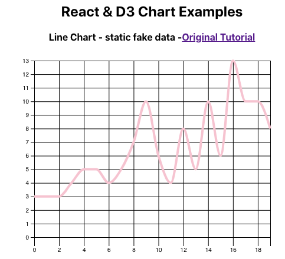
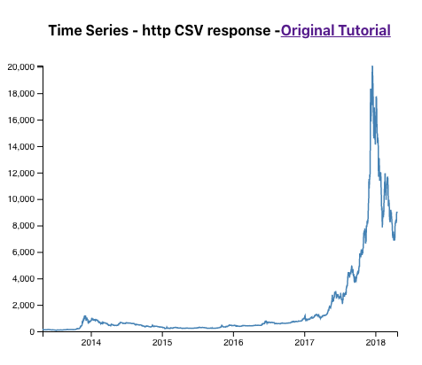
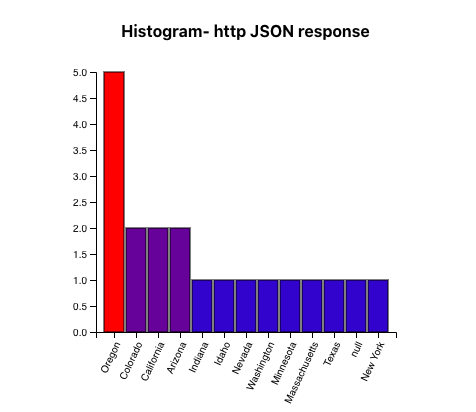

# React & D3 Chart Examples

Three D3.js charts rendered inside React function components, written in TypeScript. Each one gets its data in a different way:

| Chart | Data source | Component |
|---|---|---|
| **Line Chart** | Random data generated in the browser | [`src/Charts/LineChart.tsx`](src/Charts/LineChart.tsx) |
| **Time Series** | CSV loaded over HTTP with `d3.csv` | [`src/Charts/TimeSeries.tsx`](src/Charts/TimeSeries.tsx) |
| **Histogram** | JSON from the [Open Brewery DB API](https://www.openbrewerydb.org/), grouped by state/region | [`src/Charts/Histogram.tsx`](src/Charts/Histogram.tsx) |

## Screenshots





## Tech stack

- [React 17](https://react.dev/) (Create React App, `react-scripts` 5)
- [D3.js v7](https://d3js.org/)
- [TypeScript 4.9](https://www.typescriptlang.org/) in strict mode

## Getting started

Requires [Node.js](https://nodejs.org/) and npm.

```bash
git clone https://github.com/alinahusak/D3_React_Line-Chart_Time-Series_Histogram.git
cd D3_React_Line-Chart_Time-Series_Histogram
npm install
npm start
```

The app opens at [http://localhost:3000](http://localhost:3000).

### Scripts

| Command | What it does |
|---|---|
| `npm start` | Runs the dev server with hot reload |
| `npm run build` | Builds a production bundle into `build/` |
| `npm test` | Runs tests in watch mode |
| `npx tsc --noEmit` | Type-checks the project without building it |

> `npm install` reports vulnerabilities in packages that `react-scripts` uses for building and the dev server. They do not end up in the browser bundle. Do not run `npm audit fix --force`: it downgrades `react-scripts` and breaks the project.

## How it works

Every chart follows the same pattern:

1. Loading the data (`getURLData` / `generateData`) and drawing it (`drawChart`) are plain functions outside the component.
2. The component keeps its data in `useState` and loads it once in a `useEffect`. If the component unmounts before the request finishes, the response is ignored.
3. A second `useEffect` calls `drawChart()` whenever the data or the size changes. It clears the container, then uses D3 to build an SVG with scales, axes and shapes.
4. D3 draws into the container through `useRef`, not an `#id` selector, so several copies of a chart can be on the same page.

React manages the component lifecycle, and D3 takes care of drawing.

```
src/
├── App.tsx             # page layout: renders all three charts
└── Charts/
    ├── LineChart.tsx   # d3.line + d3.curveMonotoneX on random data
    ├── TimeSeries.tsx  # d3.scaleTime + d3.line on CSV data
    └── Histogram.tsx   # d3.scaleBand bars, colored by frequency
```

## Credits

- Based on the [React & D3 YouTube tutorial](https://youtu.be/fnucrqRHSlo)
- Line Chart: [Better Programming article](https://betterprogramming.pub/react-d3-plotting-a-line-chart-with-tooltips-ed41a4c31f4f)
- Time Series: [D3 Graph Gallery](https://www.d3-graph-gallery.com/graph/line_basic.html), data from [holtzy/data_to_viz](https://github.com/holtzy/data_to_viz)
- Histogram data: [Open Brewery DB](https://www.openbrewerydb.org/)
